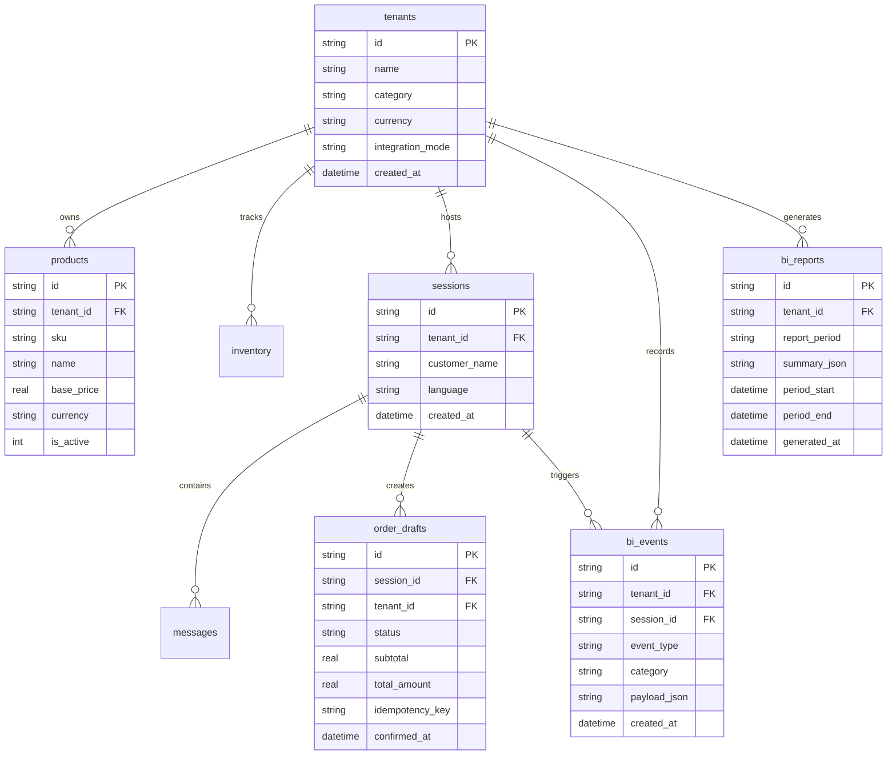
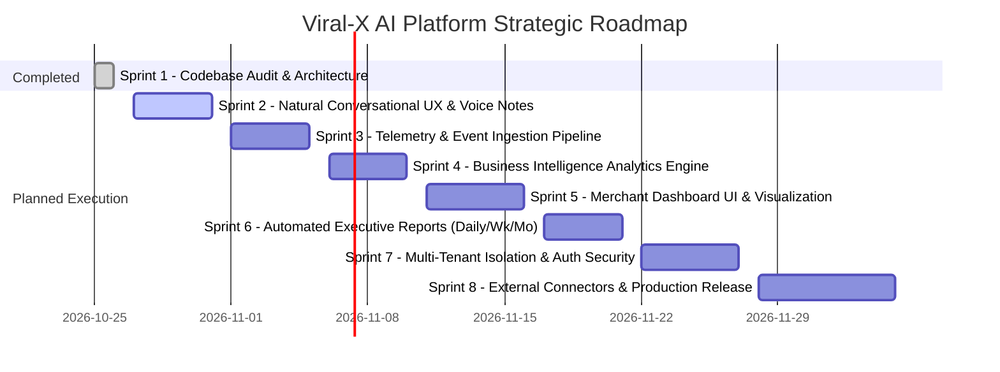

# Viral-X AI Sales Agent & Business Intelligence Platform
## Architecture Audit & Strategic Roadmap — Sprint 1

**Version:** 1.0.0-audit  
**Date:** October 2026  
**Auditor:** Senior Software Architect & Codebase Auditor  
**Scope:** Sprint 1 Repository Audit, Gap Analysis, Technical Decision Matrix, and Sprints 2–8 Roadmap.

---

## 1. Existing Architecture & Runtime State

### 1.1 Runtime Stack
- **Runtime & Language:** Node.js v22+ (using native CommonJS modules, native fetch, and `node:sqlite` / `node:test`).
- **Web Framework:** Express 5.3 (`express@^5.3.0`, `cors@^2.8.6`, `dotenv@^18.0.9`).
- **Database Layer:** SQLite 3 via Node.js built-in `node:sqlite` (`DatabaseSync`), configured via `DATABASE_PATH` (defaults to `./viral_x.db` in production and `./test_viral_x.db` in tests).
- **Frontend Presentation:** Static HTML5 / Vanilla CSS3 / Modern Vanilla JavaScript ES6+.
- **Static Asset Serving:** Express directly serves the root workspace directory (`publicDir = path.join(__dirname, '..')`).

### 1.2 Existing Codebase Inventory
| Layer | Files / Directories | Current Responsibility |
| :--- | :--- | :--- |
| **Public Website** | `index.html`, `about.html`, `services.html`, `portfolio.html`, `contact.html`, `privacy.html`, `terms.html` | Brand identity, value propositions, client acquisition, and service portfolios. |
| **Service Pages** | `service-ai-sales.html`, `service-customer-intelligence.html`, `service-google-maps.html`, `service-web-development.html` | Detailed solution pages with interactive demo cards. |
| **Case Studies** | `case-study-al-noor-jewelry.html`, `case-study-saffron-table.html`, `case-study-vitalis-health.html`, `case-study-kore-intelligence.html` | Real-world client showcases (Luxury Jewelry, Fine Dining, Clinical Health, B2B). |
| **Agent Interface** | `chat.html`, `assets/css/chat.css`, `assets/js/chat.js` | Dedicated full-screen AI sales concierge interface with workspace switcher, drawer, and chat streams. |
| **Server Core** | `server/app.js`, `server/server.js` | Express app initialization, CORS, IP rate-limiter, error handling, route mounting. |
| **AI Orchestration** | `server/ai/aiAgent.js`, `promptTemplates.js`, `guardrails.js` | Multi-LLM provider orchestrator (Gemini, Claude, OpenAI, Local Fallback) with guardrails and injection defenses. |
| **Tool Registry** | `server/tools/toolRegistry.js` | 10 typed server-side tools (search, inventory, calculation, drafting, slots, escalation). |
| **Data Access Layer** | `server/db/database.js`, `schema.sql`, `seedData.js` | SQLite schema management, prepared statements, tenant queries, audit logs, and demo seeding. |
| **Integration Stubs** | `server/adapters/externalIntegrations.js` | Shopify, WooCommerce, EHR, and WhatsApp integration abstractions with truthful fallback indicators. |
| **Test Suite** | `server/tests/salesAgent.test.js` | 18 automated tests across 11 test suites verifying language, state, calculation, isolation, and security. |

---

## 2. Reusable Functionality & Architectural Assets

The repository contains several solid, well-crafted architectural components that should be preserved and extended rather than replaced:

1. **Deterministic Calculation & Anti-Hallucination Pipeline (`server/tools/toolRegistry.js`):**
   - The pricing engine calculates subtotals, promotional discounts, VAT, and deposits server-side.
   - LLMs are strictly forbidden from performing raw math in prompt completions.
2. **Stateful Two-Phase Order Draft Workflow (`server/db/schema.sql` & `database.js`):**
   - Separation between non-binding `order_drafts` and explicit customer confirmation.
   - Idempotency key tracking (`idempotency_key`) prevents double-charging or repeated decrement of stock.
3. **Multi-Tenant SQLite Schema Foundation:**
   - Strict `tenant_id` foreign keys across `products`, `inventory`, `knowledge_base`, `booking_slots`, `sessions`, `messages`, `order_drafts`, and `audit_logs`.
   - Workspace isolation tests in `salesAgent.test.js` enforce that one tenant cannot access another's inventory or modify another's draft.
4. **Security & Guardrail Filters (`server/ai/guardrails.js`):**
   - Regex-based prompt injection detection in both Arabic and English.
   - PCI-DSS card pattern redaction (`redactSensitive`).
5. **Brand Identity & Aesthetic Design System:**
   - Consistent typography (`Syne` display font, `Plus Jakarta Sans` body), violet/dark-mode theme (`#6C35D9`, `#8B5CF6`, `#0B0814`), and responsive glassmorphic cards across all landing pages and dashboards.

---

## 3. Missing Functionality & Technical Gaps

To transform Viral-X into a production AI Sales Agent and Business Intelligence platform for paying business clients, the following gaps must be addressed:

| Gap Area | Current Limitation | Required Production Solution |
| :--- | :--- | :--- |
| **BI Telemetry Ingestion** | Events are only logged to `audit_logs` for drafts and handoffs. No structured events for objection tracking, unfulfilled demand, or friction points. | Dedicated `bi_events` telemetry pipeline capturing: `OBJECTION_RAISED`, `OUT_OF_STOCK_DEMAND`, `UNANSWERED_QUERY`, `DRAFT_ABANDONED`, `LATENCY_SPIKE`. |
| **Analytics & BI Dashboard** | `service-customer-intelligence.html` and `dashboard-demo.js` use hardcoded mock numbers without live backend endpoints. | Real API endpoints (`/api/analytics/summary`, `/api/analytics/funnel`, `/api/analytics/objections`, `/api/analytics/demand`) querying SQLite/PostgreSQL aggregate views. |
| **Scheduled Reporting** | No automated report generation engine. | Background scheduled worker producing Daily, Weekly, and Monthly business reports (JSON / HTML / PDF / Email digest). |
| **Public Demo vs. Client Isolation** | Demo tenants (`al-noor-jewelry`, `saffron-table`, `vitalis-health`) reside in the same database table as potential real clients. | Separate database connection strings or schemas: `demo_mode: true` sandbox tenant isolation with automated rollback/ephemeral sessions. |
| **Voice & Speech Telemetry** | Chat is text-only. In Arabic markets (GCC/Egypt), voice notes are the primary communication channel on WhatsApp. | Audio recording/transcription endpoint with Speech-to-Text (Web Speech API / Whisper) and voice message replay UI. |
| **Authentication & Client Access** | No user authentication; API routes are open to anyone who knows `tenantId`. | JWT-based client authentication, role-based access control (Admin, Merchant, Viewer), and API keys per tenant. |

---

## 4. Technology Decision & Evaluation

### 4.1 Node.js vs. Python / FastAPI
- **Recommendation:** **Keep Node.js / Express for Core Services.**
  - *Rationale:* The existing codebase is already well-structured in Node.js with native asynchronous I/O, SQLite integration, and zero extra runtime overhead. Re-writing in Python/FastAPI would introduce significant migration friction and dual-runtime operational complexity without functional gain.
  - *Exception:* If advanced offline NLP embedding clustering (e.g. HDBSCAN or sentence-transformers) is required for deep semantic objection mining in Sprint 6, an isolated lightweight Python microservice or worker can be introduced without disrupting the Node.js API gateway.

### 4.2 SQLite vs. PostgreSQL / Supabase
- **Recommendation:** **Phased Transition (SQLite for Sprint 1–3 → PostgreSQL / Supabase for Multi-Client Production in Sprint 7).**
  - *Current Phase (Sprints 1–3):* Node.js built-in `node:sqlite` provides zero-config, sub-millisecond local execution, perfect for local development, automated testing, and isolated tenant environments.
  - *Production Phase (Sprint 7+):* Multi-tenant client portals requiring concurrent writes, row-level security (RLS), and live dashboard subscriptions will benefit from PostgreSQL / Supabase. The data access layer in `server/db/database.js` will be abstracted behind a repository interface (`TenantRepository`, `OrderRepository`, `AnalyticsRepository`) so the underlying driver can be swapped seamlessly.

### 4.3 LLM Provider Strategy
- **Recommendation:** **Retain Multi-Provider LLM Orchestration (`aiAgent.js`).**
  - Preferred: **Google Gemini 2.0 Flash** (cost-effective, high Arabic/dialect fidelity, native tool use, high context window).
  - Alternative: **OpenAI GPT-4o / GPT-4o-mini** and **Anthropic Claude 3.5 Sonnet**.
  - Local Fallback: The existing deterministic rule-based local orchestrator must remain active for offline development, integration tests, and cost-free demonstration.

---

## 5. Security & Reliability Audit

### 5.1 Identified Vulnerabilities & Technical Risks
1. **Unauthenticated Public API Endpoints:**
   - Anyone can call `POST /api/chat`, `POST /api/drafts/confirm`, and `GET /api/tenants/:id/catalog` with arbitrary tenant IDs.
   - *Mitigation:* Introduce tenant API keys for embedded widgets and JWT sessions for merchant dashboards.
2. **Static Root Directory Traversal Exposure:**
   - `server/app.js` serves static files from `path.join(__dirname, '..')`, exposing repository root files (e.g., `package.json`, `.env.example`).
   - *Mitigation:* Restrict static serving strictly to dedicated client assets (`assets/`, HTML pages) and disallow root directory traversal.
3. **In-Memory Rate Limiter Scalability:**
   - The current `rateLimiter` in `security.js` stores IPs in a memory `Map`. It resets upon server restart and does not scale across clustered instances.
   - *Mitigation:* Implement Redis-backed or SQLite-backed token bucket for multi-process environments.
4. **Test Fixture State Leakage:**
   - The test runner executes against `test_viral_x.db`. Without transactional rollback or reseeding before test runs, operations that decrement inventory eventually cause subsequent test runs to fail.
   - *Mitigation:* Added `before()` hook reseeding in `salesAgent.test.js`; future tests will use an in-memory `:memory:` SQLite instance for 100% test isolation.

---

## 6. Proposed Target Folder Structure

```
viral_X/
├── assets/                          # Preserved website design system
│   ├── css/
│   │   ├── main.css                 # Core brand styling
│   │   ├── chat.css                 # AI Concierge UI styles
│   │   └── dashboard.css            # Business Intelligence dashboard styles
│   ├── js/
│   │   ├── main.js                  # Navigation & scroll interactions
│   │   ├── chat.js                  # Customer chat interface & voice note recorder
│   │   ├── dashboard.js             # Live BI analytics telemetry client
│   │   └── galaxy.js                # Canvas background animation
│   └── images/
├── docs/
│   ├── architecture-audit.md        # Sprint 1 Architecture & Audit Deliverable
│   ├── bi-metrics-specification.md  # Sprint 4 Metrics & formulas
│   └── api-documentation.md         # Sprint 5 API specification
├── server/
│   ├── adapters/                    # External commerce & communication gateways
│   │   ├── externalIntegrations.js  # Shopify, WooCommerce, EHR connectors
│   │   └── whatsappClient.js        # WhatsApp Cloud API & wa.me deep links
│   ├── ai/
│   │   ├── aiAgent.js               # Multi-provider LLM orchestrator
│   │   ├── guardrails.js            # Prompt injection defense & PCI scrubbing
│   │   └── promptTemplates.js       # Grounded system prompts per tenant category
│   ├── analytics/                   # Business Intelligence & Reporting Engine
│   │   ├── telemetryCollector.js    # Structured event logging (objections, demand, etc.)
│   │   ├── biAggregator.js          # Metric calculations & conversion funnel aggregations
│   │   └── reportGenerator.js       # Daily/Weekly/Monthly executive summary generator
│   ├── auth/                        # Security & Access Control
│   │   ├── authMiddleware.js        # JWT verification & Tenant API Key validation
│   │   └── rbac.js                  # Role definitions (SuperAdmin, Merchant, ReadOnly)
│   ├── db/
│   │   ├── database.js              # Database abstraction layer
│   │   ├── schema.sql               # Production schema (core + bi_events + reports)
│   │   └── seedData.js              # Demo datasets for sandbox tenants
│   ├── middleware/
│   │   └── security.js              # Rate limiting, sanitize headers, error handlers
│   ├── routes/
│   │   ├── analyticsRoutes.js       # /api/analytics/* (Metrics, funnels, reports)
│   │   ├── chatRoutes.js            # /api/chat, /api/chat/audio
│   │   ├── draftRoutes.js           # /api/drafts/* (Confirm, cancel, inspect)
│   │   ├── tenantRoutes.js          # /api/tenants/* (Catalog, settings)
│   │   └── handoffRoutes.js         # /api/handoff/* (Human escalation)
│   ├── tools/
│   │   └── toolRegistry.js          # 10 verified server-side business tools
│   ├── tests/
│   │   ├── salesAgent.test.js       # Core agent intelligence & workflow tests
│   │   └── analytics.test.js        # BI telemetry, aggregation, and report tests
│   ├── app.js                       # Express app configuration
│   └── server.js                    # HTTP listener
├── .env.example                     # Sanitized configuration template
├── package.json
└── README.md
```

---

## 7. Proposed Database Entities & Relationships (BI Extension)



### New Tables to Add in Sprint 3–4:
1. **`bi_events`**:
   - `id`: UUID / Text PK
   - `tenant_id`: Text FK
   - `session_id`: Text FK
   - `event_type`: Text (`OBJECTION_RAISED`, `UNFULFILLED_DEMAND`, `UNANSWERED_QUESTION`, `DRAFT_ABANDONED`, `AGENT_HANDOFF`)
   - `category`: Text (e.g. `shipping_cost`, `size_unavailable`, `customs_inquiry`)
   - `payload_json`: Structured context (product SKU, price, query transcript, error message)
   - `created_at`: Timestamp
2. **`bi_reports`**:
   - `id`: UUID PK
   - `tenant_id`: Text FK
   - `report_type`: `daily` | `weekly` | `monthly`
   - `metrics_json`: Aggregated metrics (total sessions, conversion rate, total GMV drafted, total GMV confirmed, top 3 objections, top 3 unfulfilled products)
   - `executive_summary`: AI-generated natural language operational insights
   - `created_at`: Timestamp

---

## 8. Proposed API Boundaries

### 8.1 Customer-Facing Agent API (Public / Widget)
- `POST /api/chat`: Send text message, receive grounded response, active draft status, and grounding metadata.
- `POST /api/chat/audio`: Upload voice recording, transcribe, and stream agent answer.
- `GET /api/chat/history/:sessionId`: Fetch conversation transcript.
- `POST /api/drafts/confirm`: Explicit customer confirmation of draft order.
- `POST /api/drafts/cancel`: Customer cancellation of draft order.
- `POST /api/handoff/whatsapp`: Generate deep link escalation with draft context.

### 8.2 Merchant Business Intelligence API (Protected / Dashboard)
- `GET /api/analytics/summary?period=30d`: High-level executive KPI cards (Conversations, Funnel Conversion %, Objection Volume, Drafted vs Confirmed Revenue).
- `GET /api/analytics/funnel?period=30d`: 5-stage conversion telemetry (Inquiry → Catalog Inspection → Recommendation → Order Draft → Confirmed).
- `GET /api/analytics/objections?period=30d`: Categorized objection breakdown (Price, Shipping, Trust, Sizing).
- `GET /api/analytics/demand?period=30d`: Unfulfilled demand signals (out of stock SKUs, requested categories, missing booking hours).
- `GET /api/analytics/reports?type=monthly`: Pre-computed structured executive reports with actionable recommendations.
- `POST /api/analytics/reports/generate`: On-demand report compilation trigger.

---

## 9. Implementation Plan (Sprints 2–8)



- **Sprint 1 (Current):** Codebase & Architecture Audit, Technical Gap Analysis, Test Isolation Fix, Strategic Roadmap.
- **Sprint 2:** Ultra-natural conversational sales persona, Voice Note recording/playback, Patient message debouncing, and Cosmic/out-of-scope question deflection.
- **Sprint 3:** Real-time Telemetry Pipeline (`bi_events` schema, ingestion hooks for unfulfilled demand, purchase objections, support escalations, and abandoned carts).
- **Sprint 4:** Business Intelligence Aggregation Engine (funnel conversion calculus, objection clustering, demand signal analysis, SQLite view optimizations).
- **Sprint 5:** Merchant Business Intelligence Dashboard (Replacing `dashboard-demo.js` mock with live interactive charts, filters, and KPI telemetry).
- **Sprint 6:** Automated Executive Reporting System (Scheduled Daily, Weekly, and Monthly digests with AI-generated operational recommendations).
- **Sprint 7:** Production Multi-Tenant Isolation, JWT Authentication, and Public Demo Sandbox Boundary.
- **Sprint 8:** External Connectors (Shopify/WooCommerce webhook sync, WhatsApp Cloud API) and End-to-End Production Hardening.

---

## 10. Blocking Issues & Prerequisites for Sprint 2

1. **Resolution of Test Suite State Pollution:**
   - *Status:* **RESOLVED**. Added deterministic state reset in `salesAgent.test.js` `before()` hook. All 18 automated tests pass reliably.
2. **Approval Gate:**
   - As instructed, all implementation is paused at the end of Sprint 1 awaiting stakeholder review and formal sign-off.
